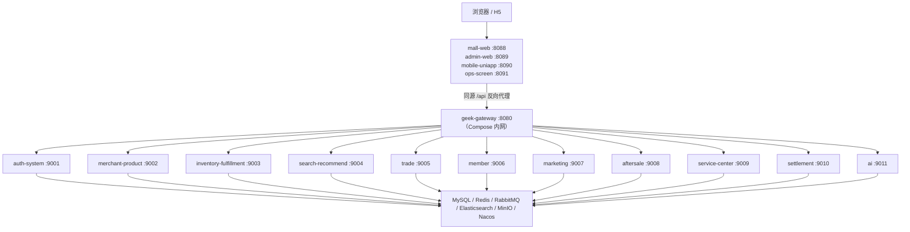
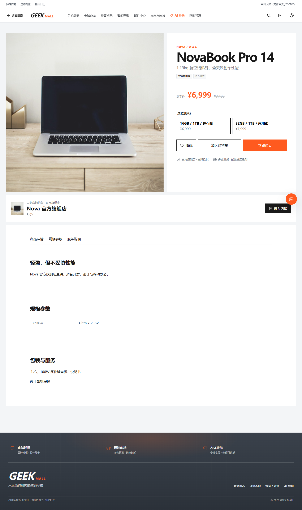
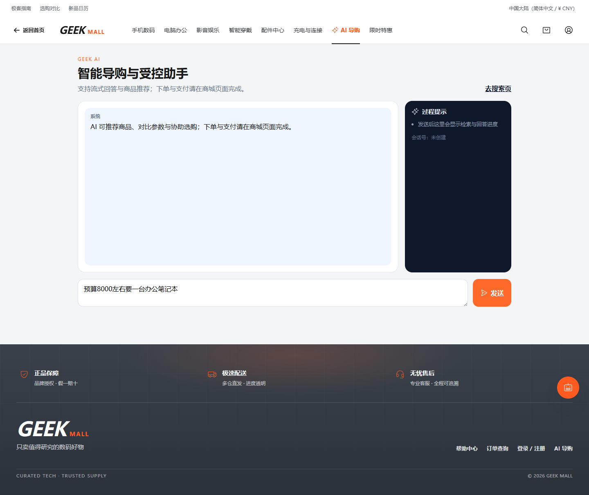
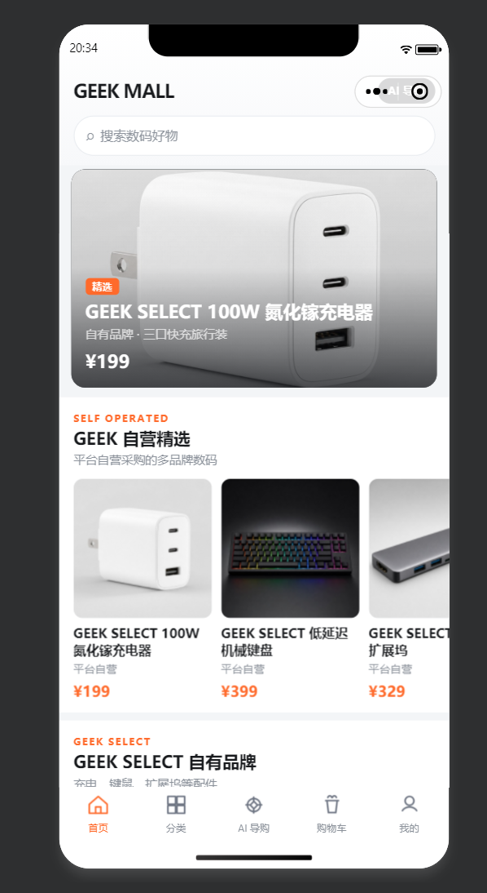
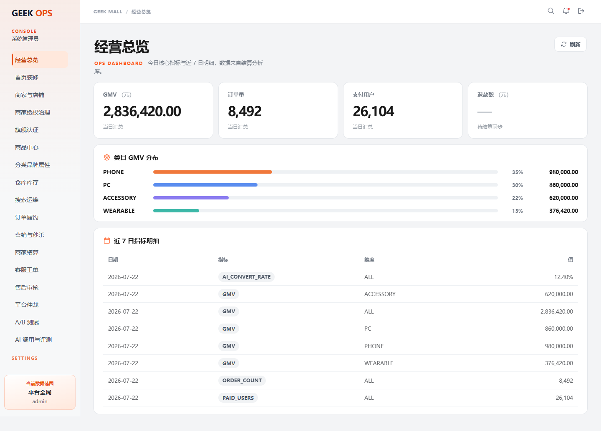

# 极客商城（Geek Mall）

## 项目定位

Geek Mall 是面向数码消费场景的本地可运行电商演示仓库。它用 Spring Cloud 微服务和 Vue 多端前端展示浏览、搜索、购物车、下单、模拟支付、库存履约、售后、运营和受控 AI 导购。

项目用于作品展示、学习和本地验收，不是已上线的生产商城。产品范围见 [`PRODUCT.md`](PRODUCT.md)，工程细节见 [`ENGINEERING.md`](ENGINEERING.md)。

## 核心亮点

- 交易主链可通过 API 自动化验证：登录、搜索、加购、结算预览、幂等下单、模拟支付和状态回查。
- 按业务域拆分服务与数据库，使用 Flyway 迁移和可重复 Seed 建立本地演示数据。
- 商家订单按 JWT 中的 `merchantId` 隔离，并有集成测试覆盖跨租户不可见。
- 库存条件更新、支付回调幂等和售后状态流转均有针对性测试；这些测试不等同于生产容量验证。
- AI 使用 Planner、工具白名单、风险分级、grounding 和规则 fallback；支付、提交订单和正式退款等高风险动作由代码拒绝。
- Compose、契约样例、API 冒烟、CI、观测配置和备份脚本集中在同一仓库。

## 技术栈

| 层 | 技术 |
|---|---|
| 后端 | Java 21、Spring Boot 3.3.5、Spring Cloud 2023.0.3、Spring Cloud Alibaba 2023.0.3.2、Maven |
| 数据与中间件 | MySQL 8.4、Redis 7.4、RabbitMQ 4.0、Elasticsearch 8.17、MinIO、Nacos、Flyway |
| 前端 | Vue 3、TypeScript、Vite 5、pnpm 11.8、Element Plus、uni-app |
| 测试与交付 | JUnit、Vitest、Playwright API、JMeter、Docker Compose、GitHub Actions、Trivy |
| 观测 | Prometheus、Grafana、Jaeger |

## 架构图



默认 Compose 只把四个前端端口绑定到 `127.0.0.1`；Gateway、业务服务和中间件留在 Compose 网络。需要本机调试中间件时，叠加 `docker-compose.debug.yml`。

## 运行方式

环境要求：JDK 21、Maven 3.8+、Node.js 22、pnpm 11.8.0，以及支持 `docker compose` 的 Docker Desktop。

首次运行或需要重新构建镜像：

```powershell
Copy-Item .env.example .env
docker compose -f docker-compose.yml config --quiet
docker compose up -d --build
```

每次正式演示前建议先执行确定性快速重置。它只操作本机 `geek-mall` Compose 项目，重建业务库，通过 Flyway/Seed 恢复固定数据，等待关键服务并完成最小交易 Smoke：

```powershell
powershell -File scripts\demo-reset.ps1 `
  -Mode Fast `
  -ConfirmLocalReset RESET_GEEK_MALL_LOCAL
```

需要同时验证连续两次重置的数据数量一致时，增加 `-VerifyRepeatability`。需要完全删除本地 Compose 数据卷时使用 `-Mode Full`；完整模式只允许删除当前项目的 `mysql-data`、`redis-data`、`rabbitmq-data`、`elasticsearch-data` 和 `minio-data`。本地业务镜像落后于源码时可增加 `-BuildImages`。两种模式均拒绝共享环境、CI、远程 Docker endpoint 或错误确认口令。

已有本地镜像时可使用演示脚本；它启动基础设施、业务服务、商城和管理端，AI 镜像不可用时会尝试本机热加载：

```powershell
powershell -File scripts\demo-up.ps1
```

`demo-up.ps1` 默认不启动移动 H5 和运营大屏；需要时执行：

```powershell
docker compose up -d --no-build mobile-uniapp ops-screen
```

前端本机开发：

```powershell
Set-Location frontend
pnpm install --frozen-lockfile
pnpm dev:mall       # 另开终端可运行 dev:admin / dev:mobile / dev:ops
```

入口：商城 `http://127.0.0.1:8088/`，管理/商家端 `http://127.0.0.1:8089/`，移动 H5 `http://127.0.0.1:8090/`，运营大屏 `http://127.0.0.1:8091/`。

## 演示账号

本地 Flyway Seed 中下列账号的密码均为 `Geek@123`。它们仅用于本地演示，不能用于共享或生产环境。

| 角色 | 用户名 | 用途 |
|---|---|---|
| 买家 | `shopper` | 商城浏览与下单 |
| 平台管理员 | `admin` | 平台管理 |
| 商家 | `merchant_a` / `merchant_b` | 商家工作台和租户隔离演示 |
| 运营 | `operator` | 平台运营功能 |
| 商品运营 | `product_admin` | 商品管理与自营代运营 |
| API 验收 | `e2e_tester` | 冒烟脚本专用，避免污染买家购物车 |

## 截图

截图单独成块展示（不再塞进表格单元格），方便在 GitHub 上直接看清界面。

### 商城首页


### 商品详情



### AI 导购



### 移动 H5



### 商家商品


### 管理后台 Dashboard



### 后台首页装修


截图索引见 [`docs/images/README.md`](docs/images/README.md)。商品封面和远程图片来源见 [`frontend/apps/mall-web/public/covers/ATTRIBUTION.md`](frontend/apps/mall-web/public/covers/ATTRIBUTION.md)。


## 验收命令

后端、前端、Compose 和契约检查：

```powershell
Set-Location backend
mvn -B -ntp verify
Set-Location ..\frontend
pnpm install --frozen-lockfile
pnpm typecheck
pnpm test
pnpm build
Set-Location ..
docker compose -f docker-compose.yml config --quiet
powershell -File scripts\contract-check.ps1
```

默认 Compose 不向宿主机发布 Gateway 8080。服务启动后，API 验收应通过商城 nginx 代理：

```powershell
$env:E2E_BASE_URL='http://127.0.0.1:8088'
powershell -File scripts\e2e-core-flow.ps1
powershell -File scripts\concurrency-verify.ps1
Set-Location e2e
pnpm install --frozen-lockfile
pnpm test:api
```

这些命令会重新生成被 Git 忽略的 `target/`、`dist/`、`reports/` 等产物。每项断言与未覆盖范围见 [`docs/ACCEPTANCE.md`](docs/ACCEPTANCE.md)。

## 已知边界

- 微信和支付宝适配器默认关闭；验收只使用 `SIMULATED`，没有真实扣款。发票结果也是模拟签发，不连接税控系统。
- AI 的本地“向量”是 64 维确定性字符哈希原型，不是真实 Embedding；Milvus 只有配置骨架，没有健康探测、写入或召回链路。
- 没有 LLM key 时验证的是规则编排与可观察降级，不代表远程模型质量或可用性已经验证；Token 和成本在缺少上游 usage 时为估算。
- Playwright 项目是 API smoke，不启动浏览器；仓库没有强制的全量 UI E2E、视觉回归或移动真机测试。
- 未验证生产级容量、长稳、故障注入、多活容灾、真实支付回调、退款到账和完整仓储物流。
- `docker-compose.yml` 是回环地址上的本地演示配置，不应直接通过公网隧道或端口映射暴露。共享环境必须更换占位密钥并重新评审入口、TLS、认证和网络策略。
- 商品封面中的 Unsplash 图片适用单独的 Unsplash License，不由根目录 MIT License 重新许可。
