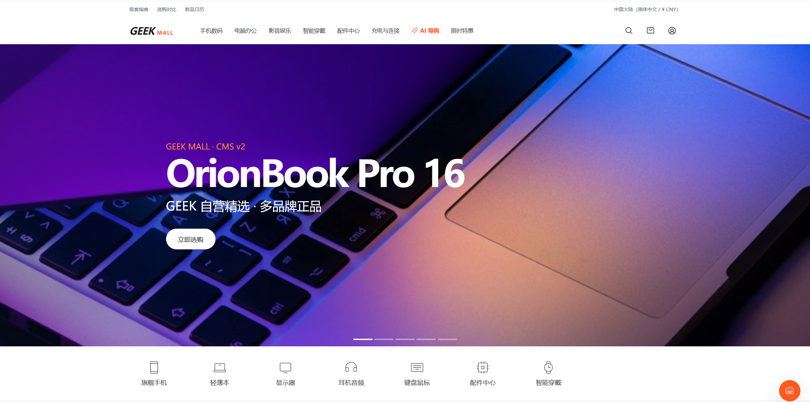
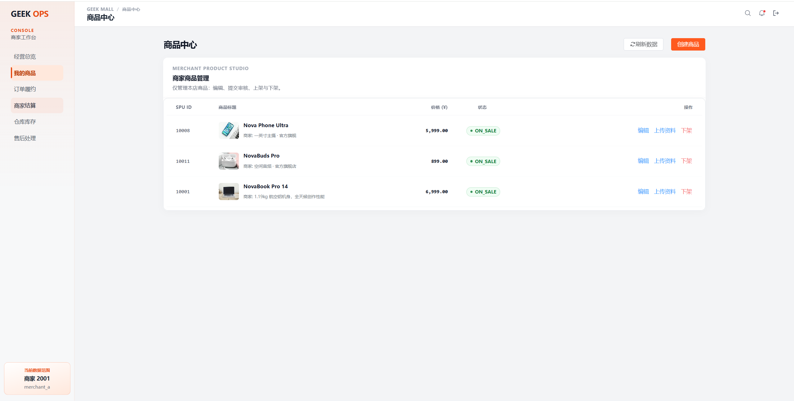
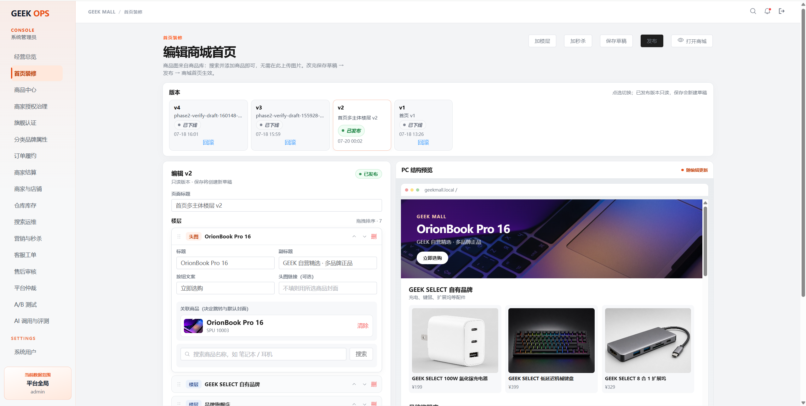

# 极客商城（Geek Mall）

面向数码消费场景的**可演示全栈电商作品**：Spring Cloud 微服务 + Vue 四端前端，覆盖浏览、搜索、加购、下单、模拟支付、履约库存、会员营销、售后、结算与 AI 导购。

> 定位是本地 / 作品集演示项目，不是已上线生产系统。  
> **微信支付、支付宝默认关闭**；演示走可插拔支付通道中的 `SIMULATED`。发票申请也返回模拟开票结果（`provider=SIMULATED`），未接入税控渠道。

---

## 项目简介与核心价值

用一套可运行的代码，把「逛 → 选 → 买 → 履约 / 售后」和「自然语言导购」两条链路讲清楚：

| 价值点 | 说明 |
|---|---|
| 交易主链可跑通 | 搜索 → 加购 → 结算 → 幂等下单 → 模拟支付 → 订单 `PAID` |
| 多角色同一后台 | 平台运营 / 商家工作台共用 `admin-web`，按登录身份切换菜单与数据范围 |
| AI 受控编排 | Planner + 工具白名单；禁止代付、代下单、正式退款 |
| 工程可复现 | Compose、Flyway 种子、契约样例、API 冒烟脚本、GitHub Actions |

---

## 系统角色与业务闭环

| 角色 | 入口 | 主要动作 |
|---|---|---|
| 访客 / 买家 | 商城 `8088`、移动端 `8090` | 浏览、搜索、加购、下单、模拟支付、查单、售后申请、发票抬头 |
| 平台管理员 | 管理后台 `8089`（`admin`） | RBAC、商品/商家治理、CMS 首页装修、营销秒杀、售后仲裁、AI 评测入口 |
| 商家 | 管理后台 `8089`（`merchant_a` 等） | 本店商品、履约、库存、售后、结算 |
| 运营值班 | 运营大屏 `8091` | 关键指标总览（Compose 服务 `ops-screen`） |

**购买主路径（P0）**

```text
浏览 / 搜索 → 详情 → 加购 → 地址与结算预览
  → 创建订单（Idempotency-Key）→ SIMULATED 支付 → 订单已支付 → 履约 / 售后
```

**品牌与销售主体（种子数据）**：GEEK MALL 平台、GEEK 自营店、自有配件品牌 GEEK SELECT、官方旗舰店、第三方店铺。

---

## 核心功能

- **商品与搜索**：SPU/SKU、类目品牌、店铺页；Elasticsearch 商品检索
- **交易**：购物车、结算预览、订单、支付单；写操作带 `X-Request-Id`，下单强制幂等键
- **支付**：默认 `SIMULATED`；`WechatPaymentChannelAdapter` / `AlipayPaymentChannelAdapter` 存在但由 `PAYMENT_WECHAT_ENABLED` / `PAYMENT_ALIPAY_ENABLED` 控制，默认 `false`
- **库存履约**：预占 / 扣减 / 超时释放；发货与物流展示（演示数据）
- **会员营销**：地址、优惠券、积分、CMS、秒杀
- **售后与结算**：售后单；商家结算 / 提现；用户发票抬头与申请（模拟签发）
- **AI 导购**：自然语言选购、工具调用（如 `search_products`）、过程事件面板；无 LLM Key 时可降级
- **首页装修**：多版本草稿 / 发布 / 回滚，PC 结构预览

---

## 技术栈

| 层 | 技术（以仓库为准） |
|---|---|
| 后端 | Java 21、Spring Boot 3.3.5、Spring Cloud 2023.0.3、Spring Cloud Alibaba 2023.0.3.2、Gateway、Nacos |
| 数据与中间件 | MySQL 8.4、Redis 7.4、RabbitMQ 4、Elasticsearch 8.17、MinIO、Flyway |
| 前端 | Vue 3、Vite 5、pnpm 11.8、TypeScript、Element Plus（管理端）、uni-app（移动端） |
| 交付 | Docker Compose、GitHub Actions（`mvn verify` / `pnpm` / Compose config / 契约 / Trivy） |

---

## 系统架构与目录

```text
浏览器 / H5
    │
    ▼
mall-web :8088 · admin-web :8089 · mobile-uniapp :8090 · ops-screen :8091
    │  （前端容器 nginx 反代 /api → gateway）
    ▼
geek-gateway :8080
    ├─ auth-system          :9001
    ├─ merchant-product     :9002
    ├─ inventory-fulfillment:9003
    ├─ search-recommend     :9004
    ├─ trade                :9005
    ├─ member               :9006
    ├─ marketing            :9007
    ├─ aftersale            :9008
    ├─ service-center       :9009
    ├─ settlement           :9010
    └─ ai                   :9011
中间件：MySQL · Redis · RabbitMQ · Nacos · Elasticsearch · MinIO
可选：Prometheus / Grafana / Jaeger（`docker-compose.observability.yml`）
```

```text
geek-mall/
├─ README.md · PRODUCT.md · ENGINEERING.md
├─ docs/                 # 验收说明、AI 编排、截图
├─ backend/              # geek-* 微服务 + geek-common
├─ frontend/apps/        # mall-web · admin-web · mobile-uniapp · ops-screen
├─ frontend/packages/    # 共享类型与工具
├─ scripts/              # demo-up、冒烟、热加载、扫描
├─ contracts/            # 领域事件 Schema 与样例
├─ e2e/                  # Playwright API 冒烟
├─ deploy/ · observability/ · perf/
├─ assets/product-covers/
└─ docker-compose*.yml · .env.example
```

更细的工程说明见 [ENGINEERING.md](ENGINEERING.md)；产品边界见 [PRODUCT.md](PRODUCT.md)。

---

## 多端说明

| 端 | 工程 | 端口 | 说明 |
|---|---|---|---|
| 用户商城 | `frontend/apps/mall-web` | 8088 | PC 站：首页 CMS、类目、详情、购物车、收银台、AI 导购 |
| 商家端 | `frontend/apps/admin-web`（商家登录） | 8089 | 我的商品、履约、库存、售后、结算 |
| 管理后台 | `frontend/apps/admin-web`（管理员登录） | 8089 | 平台治理、首页装修、营销、AI 评测等 |
| 移动端 | `frontend/apps/mobile-uniapp` | 8090 | H5；微信小程序构建产物见 `dist/build/mp-weixin`（不接真实微信登录/支付） |
| 运营大屏 | `frontend/apps/ops-screen` | 8091 | Compose 服务名 `ops-screen`；`demo-up.ps1` 默认不拉起 |

---

## 项目截图

### 用户商城




### 移动端


### 商家端



### 管理后台



---

## 环境要求

| 依赖 | 建议版本 |
|---|---|
| JDK | 21+ |
| Maven | 3.8+ |
| Node.js | 22（与 CI 一致） |
| pnpm | 11.8.0（`frontend/package.json` 的 `packageManager`） |
| Docker Desktop | 需可用 `docker compose` |

内存建议：日常用 Compose 跑中间件 + 业务容器；**低配机避免**全量 `docker compose up --build` 在容器内编译全部后端。

---

## 本地启动

### 1）配置环境变量

```powershell
Copy-Item .env.example .env
# 按需填写 LLM_API_KEY（仅本地 .env，已 gitignore）
# 支付真实通道保持关闭：
#   PAYMENT_WECHAT_ENABLED=false
#   PAYMENT_ALIPAY_ENABLED=false
```

### 2）推荐：演示一键脚本

```powershell
powershell -File scripts\demo-up.ps1
```

脚本会：

1. 若无 `.env` 则从 `.env.example` 复制  
2. 拉起中间件与业务服务（`--no-build`，使用已有镜像）  
3. AI 优先 Compose；镜像不可用时回退本机热加载 `:9011`  
4. 重建 gateway，并启动 **mall-web / admin-web**

移动端与运营大屏需额外：

```powershell
docker compose up -d --no-build mobile-uniapp ops-screen
```

### 3）Docker Compose（全量 / 首次构建）

```powershell
docker compose -f docker-compose.yml config   # 校验
docker compose up -d --build                  # 首次或需重建镜像时
```

可选观测栈：

```powershell
docker compose -f docker-compose.yml -f docker-compose.observability.yml up -d --no-build
```

### 4）前端本机开发（可选）

```powershell
cd frontend
pnpm install
pnpm dev:mall    # 商城
pnpm dev:admin   # 管理 / 商家
pnpm dev:mobile  # uni-app
pnpm dev:ops     # 运营大屏
```

容器内前端构建时 `VITE_API_BASE_URL` 为空，由 nginx 把 `/api` 反代到 gateway。

---

## 演示地址与账号

| 入口 | 地址 |
|---|---|
| 商城 | http://127.0.0.1:8088/ |
| AI 导购 | http://127.0.0.1:8088/ai-shopping |
| 管理 / 商家后台 | http://127.0.0.1:8089/ |
| 移动 H5 | http://127.0.0.1:8090/ |
| 运营大屏 | http://127.0.0.1:8091/ |
| API Gateway | http://127.0.0.1:8080/ |
| RabbitMQ 管理台 | http://127.0.0.1:15672/ |
| MinIO API / Console | http://127.0.0.1:9100/ · http://127.0.0.1:9101/ |
| Nacos | http://127.0.0.1:8848/nacos/ |

### 演示账号（仅本地，Flyway 种子）

密码均为 `Geek@123`（`R__phase1_seed.sql` 中同一哈希；**勿用于生产**）。

| 角色 | 用户名 | 用途 |
|---|---|---|
| 买家 | `shopper` | 前台下单演示 |
| 管理员 | `admin` | 平台后台 |
| 商家 | `merchant_a` / `merchant_b` | 商家工作台 |
| 运营 | `operator` | 平台运营角色 |
| 商品运营 | `product_admin` | 商品管理 / 自营代运营 |
| API 验收 | `e2e_tester` | 冒烟脚本默认用户，避免污染 `shopper` 购物车 |

登录页**不预填、不展示**演示账号文案。

---

## 数据初始化

- 各服务启动时由 **Flyway** 执行 `backend/geek-*/src/main/resources/db/migration/`  
- 可重复种子脚本多为 `R__*.sql`（用户、角色、商品、CMS、演示订单相关数据等）  
- 业务库按域拆分，例如：`geek_system`、`geek_merchant_product`、`geek_trade`、`geek_inventory`、`geek_member`、`geek_marketing`、`geek_aftersale`、`geek_service`、`geek_settlement`、`geek_search`、`geek_ai`  
- 权威交易表在 `geek_trade`（如 `trade_order`）；勿把早期样例表当成真实订单源  
- 商品封面运行时由商城静态资源 `/covers/*.jpg` 提供

无需单独执行手工 SQL；空库首次启动服务即可迁移并灌种。

---

## 核心接口与验收

对外统一前缀：`http://127.0.0.1:8080/api/v1/**`

| 能力 | 示例 |
|---|---|
| 登录 | `POST /api/v1/auth/login/password` |
| 搜索 | `GET /api/v1/search/products` |
| 购物车 | `POST /api/v1/trade/cart/items` |
| 结算预览 | `POST /api/v1/trade/checkout/preview` |
| 下单 | `POST /api/v1/trade/orders`（需 `Idempotency-Key`） |
| 支付 | `POST /api/v1/payments`（body `channel=SIMULATED`） |
| 发票 | `POST /api/v1/user/invoices`（返回模拟 `ISSUED`） |

### 本地验收命令

```powershell
powershell -File scripts\e2e-core-flow.ps1          # 交易主链 API
powershell -File scripts\showcase-phase5.ps1        # 展示面 + 主链
powershell -File scripts\contract-check.ps1         # 契约样例
cd backend; mvn -B -ntp verify
cd frontend; pnpm typecheck; pnpm test; pnpm build
```

公开验收范围与边界：[docs/ACCEPTANCE.md](docs/ACCEPTANCE.md)。文档记载近期本地重跑 `showcase-phase5` / `e2e-core-flow` / `stage4-verify` / `stage5-verify` 可通过，订单可达 `PAID`；**以你本机实际跑通结果为准**。

CI：`.github/workflows/ci.yml`（后端 verify、前端 typecheck/test/build、Compose config、契约、Trivy）。

---

## 项目亮点

1. **幂等与库存**：下单幂等键 + 库存条件更新预占；支付回调幂等有单测覆盖  
2. **支付可插拔**：真实微信 / 支付宝适配器与开关分离，演示默认模拟通道  
3. **AI 护栏**：工具白名单与风险分级，L4 动作拒绝执行（详见 [docs/ai-orchestration.md](docs/ai-orchestration.md)）  
4. **CMS 多版本**：首页草稿、发布、回滚与 PC 预览  
5. **多端一致 API**：四端共用 Gateway；Compose 与本机热加载可切换  

---

## 已实现范围与已知限制

**已实现（演示完整度较高）**：商品搜索、交易主链、模拟支付、库存履约、会员地址、CMS/秒杀、商家商品与结算路径、售后主流程、AI 导购（依赖可选 LLM Key）。

**限制与非目标**

- 未接入真实微信 / 支付宝扣款；未接入税控电子发票  
- AI OCR/VL、Milvus 为可开关 / 可替换骨架（`.env.example` 中 `MILVUS_ENABLED=false`）  
- 浏览器级全量 UI E2E 非强制；核心交易以 API 冒烟为准  
- 移动端完整 AI 对话体验以 PC 商城为主；小程序需微信开发者工具导入构建产物  
- `demo-up.ps1` 默认不启动 `mobile-uniapp` / `ops-screen`  
- 不宣称生产级高并发或全量功能已完备测试  

---

## 相关文档

| 文档 | 内容 |
|---|---|
| [PRODUCT.md](PRODUCT.md) | 产品定位、角色、流程与范围 |
| [ENGINEERING.md](ENGINEERING.md) | 架构、目录、数据、部署与测试 |
| [docs/ACCEPTANCE.md](docs/ACCEPTANCE.md) | 公开验收范围 |
| [docs/ai-orchestration.md](docs/ai-orchestration.md) | AI Planner 与护栏 |
| [docs/images/](docs/images/) | 作品集截图 |

封面素材归属见 `frontend/apps/mall-web/public/covers/ATTRIBUTION.md`。

## 许可证

个人作品集与学习演示用途。
